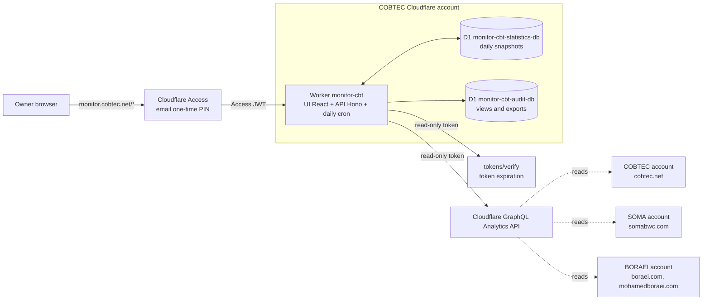

# Architecture — monitor-cbt

## Overview
monitor-cbt is **a single Cloudflare Worker** (`monitor-cbt`) in the COBTEC account, published at
`monitor.cobtec.net`. It does three things:
1. **Serves the UI** (React): a home page with a module selector (today only "Cloudflare - Consumo y Tráfico")
   that leads to each monitoring dashboard. Further API-based monitoring modules can be added later.
2. **Exposes its own API** (`/api/*`), which only answers authenticated users.
3. **Runs a daily scheduled task** that, shortly after 00:00 UTC (19:00 ECT), copies the previous
   day's statistics into the D1 database `monitor-cbt-statistics-db`. Data views and exports are
   recorded in a separate D1 database, `monitor-cbt-audit-db`.

**Cloudflare Access** (email one-time PIN) protects the whole hostname `monitor.cobtec.net`, from
the root: without a valid code nothing is served (no page, no UI files, no API). The Worker validates
the Access JWT again on every API request and checks its own email allowlist. `workers.dev` and
preview URLs are disabled so there is no entry point without Access.

To read data, the Worker calls the Cloudflare **GraphQL Analytics API** (3 accounts, 4 zones) and
`tokens/verify` (token expiration) with the read-only token stored as a Worker secret. The UI never
talks to Cloudflare directly, only to the Worker's API. When the dashboard opens, the Worker combines
the D1 history with recent data from the API.

## Diagram

## Main flows
1. **Sign in:** open `monitor.cobtec.net` → Access asks for email and one-time code → home page with
   the module selector → choose the module → dashboard. On every API call the Worker validates the
   JWT and the email allowlist, and records the view in the audit log.
2. **View the dashboard:** the UI requests data from `/api` → the Worker reads the history from D1,
   completes recent data (today, partial) from the GraphQL API, and adds the token's remaining days.
3. **Daily task:** shortly after 00:00 UTC (19:00 ECT) the Worker requests the previous day from
   GraphQL for each account and zone → stores it in D1 → deletes IPs older than 13 months. If a day
   fails, the next run fills in the missing days while the API still retains them.
4. **Export:** the UI builds the Excel or PDF file in the browser from the data already on screen,
   and notifies the API so the export is recorded in the audit log.

## Security model
- **Who can enter:** only emails that are both in the Access policy and in the Worker's allowlist.
  One role today: owner.
- **Identity:** Cloudflare Access email one-time PIN over the whole hostname. Session duration:
  24 hours (can be raised to 7 days in Access without code changes if it proves inconvenient).
- **Where permissions are enforced:** in the Worker, on every `/api/*` call (Access JWT + allowlist).
  The Cloudflare token never leaves the Worker; responses carry only the data each screen needs.
- **What is recorded:** sign-ins in Cloudflare Access (kept only 24 hours on the Free plan); data views and exports in the D1 database `monitor-cbt-audit-db`.

## External services and integrations
| Service | Purpose | If it does not respond |
|---|---|---|
| Cloudflare GraphQL Analytics API | Usage and traffic data | The dashboard shows the D1 history with the notice "No pudimos leer los datos recientes de Cloudflare. Se muestra el historial guardado hasta el <fecha>."; the daily task fills the gap on its next run. |
| Cloudflare `tokens/verify` | Token's remaining days | The token notice says it could not be verified; it is never hidden. |
| Cloudflare Access | Sign-in with one-time PIN | Nobody can enter (fail closed). |
| One-time PIN email (sent by Cloudflare) | Delivers the sign-in code | If it does not arrive, nobody can enter; outside the project's control. |

No other external services: the IBM Plex Sans and IBM Plex Mono fonts (OFL license) are bundled
with the app, so the browser never calls Google Fonts.

## Key decisions
<!-- Decisiones de arquitectura que afectan a todo el sistema, con su motivo. Las decisiones de cada funcionalidad viven en las specs. -->
| Date | Decision | Reason |
|---|---|---|
| 2026-10-28 | Single Worker with Hono + React/Vite (Workers Static Assets) | The daily cron stays simple; the CBT design arrives as React |
| 2026-10-28 | Code in `web/` | Consistency with the owner's other projects |
| 2026-10-28 | No staging (local and production only) | Internal, read-only, single-user tool |
| 2026-10-28 | Cloudflare Access email one-time PIN over the whole hostname, no public page | Without a code nothing is visible; one rule, less risk |
| 2026-10-28 | Double barrier: Access JWT + email allowlist in the Worker | A mistake in the Access policy does not open the dashboard |
| 2026-10-28 | Access session of 24 hours | Occasional use; sensitive data on screen |
| 2026-10-28 | Daily history in D1 | The API retains only a few days |
| 2026-10-28 | A statistics "day" = Cloudflare's UTC day (19:00 to 19:00 ECT) | Matches the daily limit reset |
| 2026-10-28 | Stored IPs: top N per day, deleted after 13 months | Security visibility with bounded personal data |
| 2026-10-28 | Audit in its own D1 database (`monitor-cbt-audit-db`), separate from statistics | Restoring statistics (Time Travel) never erases audit records; separate size limits and exports |
| 2026-10-28 | IBM Plex fonts bundled with the app | No calls to Google |
| 2026-10-28 | New, project-specific read-only token, expiration of 1 year or less | Independent from the SOMA usage panel |
